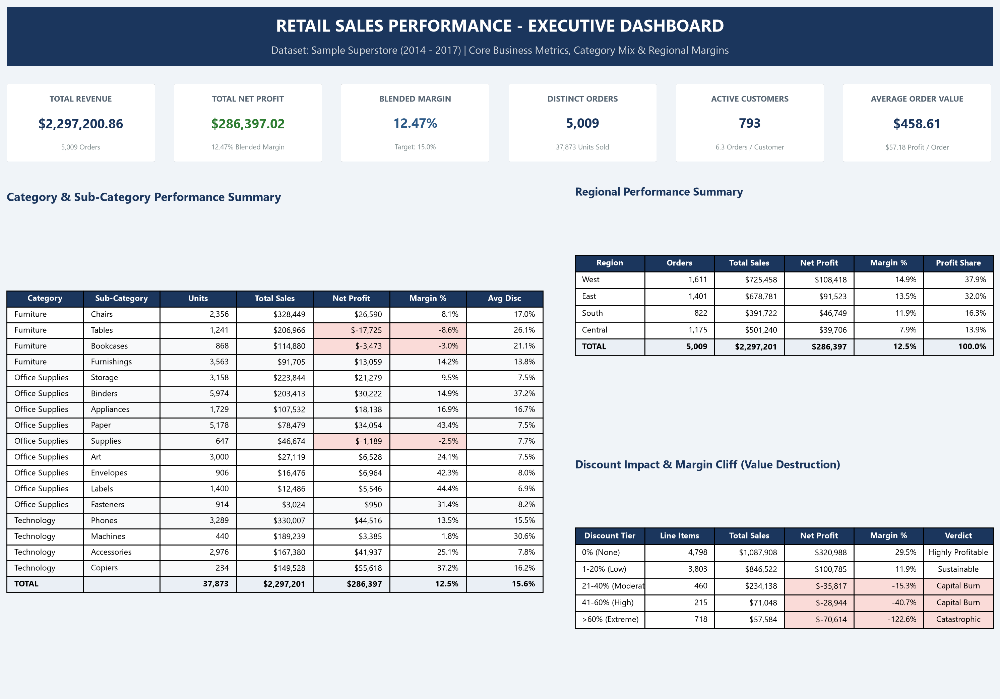
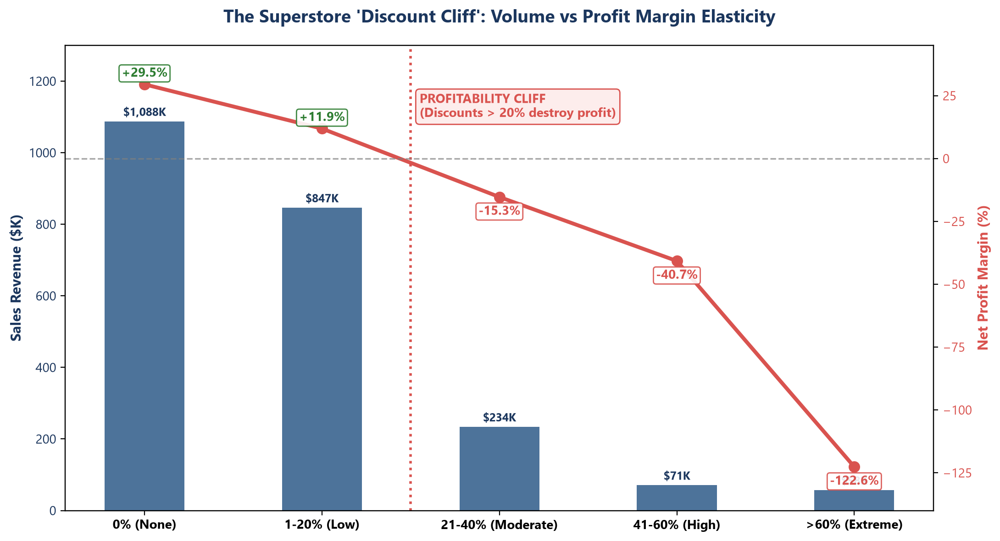
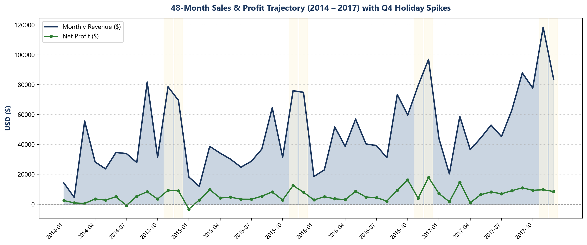
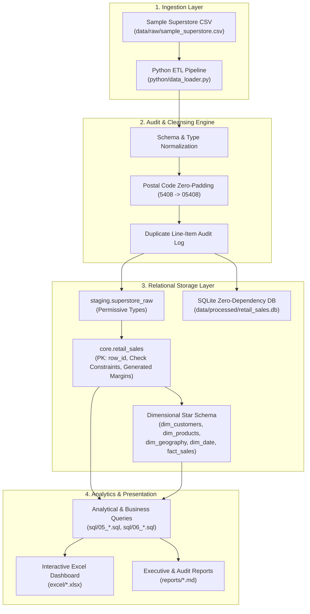

# Retail Sales Performance Analysis

[](https://www.postgresql.org/)
[](https://www.python.org/)
[](https://www.microsoft.com/excel)
[](https://docs.pytest.org/)
[](LICENSE)

An end-to-end data engineering, SQL analytics, and business intelligence portfolio project analyzing retail sales transactions from the **Sample Superstore** dataset. 

Designed for **Data Analyst job applications**, **GitHub portfolio demonstration**, **technical SQL interviews**, and **executive dashboard presentations**.

---

## 📑 Table of Contents
- [Executive Overview](#-executive-overview)
- [The Business Problem](#-the-business-problem)
- [Key Business Findings](#-key-business-findings)
- [Excel Executive Dashboard](#-excel-executive-dashboard)
- [Dataset Description](#-dataset-description)
- [Technology Stack](#-technology-stack)
- [Project Architecture](#-project-architecture)
- [Python ETL & Validation Pipeline](#-python-etl--validation-pipeline)
- [SQL Analytical Capabilities & Query Showcase](#-sql-analytical-capabilities--query-showcase)
- [Data Quality & Cleansing Methodology](#-data-quality--cleansing-methodology)
- [Installation & Execution Guide](#-installation--execution-guide-windows-powershell)
- [PostgreSQL Database Setup](#-postgresql-database-setup)
- [Project Limitations & Assumptions](#-project-limitations--assumptions)
- [Portfolio Documentation Index](#-portfolio-documentation-index)
- [Author & License](#-author--license)

---

## 📌 Executive Overview

Over the 4-year operating period from 2014 through 2017, the retail enterprise recorded **\$2,297,200.86 in gross sales revenue** and **\$286,397.02 in net profit** across **5,009 distinct customer orders** (comprising **9,994 transaction line items**), yielding an overall **blended profit margin of 12.47%**.

```
+-------------------------------------------------------------------------------------------------+
| Total Gross Revenue | Total Net Profit | Blended Margin | Distinct Orders | Line Items | Customers |
|   $2,297,200.86     |   $286,397.02    |     12.47%     |      5,009      |   9,994    |    793    |
+-------------------------------------------------------------------------------------------------+
```

While annualized top-line revenue demonstrated steady expansion (+20.4% compound growth), an in-depth financial autopsy reveals significant margin leakage: uncoordinated sales discounting, chronic product losses in the Furniture division, and severe regional underperformance in the Central United States.

---

## 🎯 The Business Problem

Despite strong top-line sales figures, executive leadership was confronted with three critical challenges:
1. **Uncontrolled Promotional Discounting:** Sales reps were applying aggressive price markdowns (up to 80%) under the assumption that volume offsets margin loss. The business had no quantitative visibility into where discounts transition from value creation to capital destruction.
2. **Product Catalog Margin Drag:** Certain sub-categories were generating massive sales volumes while quietly eroding profitability due to high fulfillment costs and unviable unit economics.
3. **Geographic Inefficiency:** Revenue was evenly distributed across territories, but net profits were heavily concentrated in the West and East. Central operations were failing to generate acceptable return on capital.

This project was developed to audit transaction integrity, establish reproducible data pipelines, quantify the true impact of discounting, and deliver an interactive dashboard for C-suite decision-making.

---

## 🔍 Key Business Findings

### 1. The "Discount Cliff" Inflection Point
A quantitative analysis across 5 discount tiers reveals an inflection threshold at **20% discount**:
- **0% Discount:** Generated **\$1,087,908.20** in revenue and **+\$320,987.60** in net profit (**+29.51% margin**).
- **1% to 20% Discount:** Generated **\$846,522.20** in revenue and **+\$100,785.47** in net profit (**+11.91% margin**).
- **>20% Discount:** Incurred severe losses. Across 1,393 transactions with discounts exceeding 20%, the company lost **-\$135,376.06 in profit**.
- **Extreme Discounts (>60%):** Generated \$57,584.04 in sales while destroying **-\$70,614.40 in profit** (**-122.63% margin**)—meaning the company lost **\$1.23 for every \$1.00 of merchandise invoiced**.

### 2. Category Performance & The Furniture Crisis
- **Technology:** Top profit engine, generating **\$836,154.03 sales** and **+\$145,454.95 profit** (**17.40% margin**).
- **Office Supplies:** Consistent cash cow, generating **\$719,047.03 sales** and **+\$122,490.80 profit** (**17.04% margin**).
- **Furniture:** Severe operational distress, generating **\$741,999.80 sales** but only **+\$18,451.27 profit** (**2.49% margin**).
  - **Tables:** Lost **-\$17,725.48** on \$206,965.53 sales (-8.56% margin).
  - **Bookcases:** Lost **-\$3,472.56** on \$114,880.00 sales (-3.02% margin).

### 3. Regional Disparities
- **West & East (Profit Engines):** Delivered 70% of enterprise profits (West: \$108.4K profit, 14.9% margin; East: \$91.5K profit, 13.5% margin).
- **Central (Margin Bleeder):** Lagged severely at **7.92% margin**, dragged down by heavy discounting in **Texas** (-\$25,729.39 loss; avg discount 37.0%) and **Illinois** (-\$12,607.89 loss; avg discount 39.0%).

### 4. Customer Pareto Distribution (80/20 Rule)
- The top **18.7% of customers** (148 accounts) generated **50% of total revenue**.
- The top **49.8% of customers** generated **80% of total revenue**, confirming that while spend is moderately concentrated, customer retention across the mid-tier is essential.

---

## 📊 Excel Executive Dashboard

The companion Microsoft Excel dashboard ([`excel/retail_sales_performance_dashboard.xlsx`](excel/retail_sales_performance_dashboard.xlsx)) provides an interactive, corporate-styled reporting interface for executive briefings.

### Executive Dashboard View

*Figure 1: Executive Dashboard layout featuring top KPI cards, Category & Sub-Category Performance Summary, Regional Breakdown, and Discount Sensitivity Cliff.*

### The Discount Cliff Visual Analysis

*Figure 2: Dual-axis visualization showing revenue volume vs. net profit margin across discount tiers, highlighting the profitability collapse past 20%.*

### 48-Month Sales & Profit Trajectory

*Figure 3: Longitudinal view of monthly sales and profit spanning 2014 through 2017, illustrating consistent Q4 holiday spikes (Nov/Dec).*

---

## 📁 Dataset Description

The dataset is derived from the standard commercial **Sample Superstore** benchmark, capturing B2B and retail transactions across the United States.

- **Temporal Coverage:** January 3, 2014 to December 30, 2017 (4 full operating years).
- **Volume:** 9,994 transaction line items, 5,009 unique customer orders, 793 active customer accounts.
- **Geographic Breadth:** 4 regions (Central, East, South, West), 49 states (including District of Columbia), and 531 unique cities.
- **Product Hierarchy:** 3 categories (Technology, Furniture, Office Supplies), 17 sub-categories, 1,862 discrete product SKUs.
- **Key Transaction Measures:** `Sales` (invoiced amount), `Quantity` (units), `Discount` (rate 0.00 to 0.80), and `Profit` (net return).

A full breakdown of all 21 columns, nullability constraints, and target PostgreSQL data types is documented in the [Data Dictionary](docs/data_dictionary.md).

---

## 🛠️ Technology Stack

| Technology | Purpose & Implementation |
| :--- | :--- |
| **PostgreSQL 12+** | Relational data warehouse schema design, Kimball Star Schema modeling, check constraints, composite B-Tree indexes, and stored generated columns. |
| **SQL (ANSI & PG)** | Window functions (`LAG`, `NTILE`, `DENSE_RANK`, `ROW_NUMBER`, `SUM() OVER`), CTEs, RFM segmentation, cohort modeling, and deduplication audit views. |
| **Python 3.10+** | Reproducible ETL pipeline (`python/data_loader.py`), automated data validation, postal code zero-padding, and test automation. |
| **Pandas & NumPy** | Data ingestion, multi-encoding fallback detection (`utf-8`, `latin1`, `cp1252`), numeric boundary validation, and aggregation. |
| **OpenPyXL** | Automated generation of styled multi-tab corporate Excel workbooks with formulas (`SUM`, `AVERAGE`, `SUMIFS`, `=Profit/Sales`). |
| **Microsoft Excel** | C-suite Executive Dashboard, KPI scorecards, Monthly Trends, and Category-Region pivot matrices. |
| **SQLite 3** | Zero-dependency, offline validation database (`data/processed/retail_sales.db`) ensuring immediate out-of-the-box SQL query execution without server setup. |
| **Pytest** | Automated unit tests validating schema conformity, date chronology, boundary constraints, and metric consistency. |
| **Git / GitHub** | Branch management, atomic commits, documentation versioning, and open-source publication. |

---

## 🏗️ Project Architecture

The project implements a modern Medallion architecture (Staging → Core → Analytics), separating raw landing data from strictly typed business tables and dimensional models.



For complete technical specifications, review the [Architecture Design Document](docs/architecture.md).

---

## 🐍 Python ETL & Validation Pipeline

The ingestion pipeline is implemented in [`python/data_loader.py`](python/data_loader.py) and executes the following sequence:

1. **Multi-Encoding Ingestion:** Attempts UTF-8 and falls back gracefully to Latin-1/CP1252 to handle non-ASCII characters without data corruption.
2. **Column Normalization:** Standardizes diverse header conventions into canonical snake_case (`Order Date` → `order_date`).
3. **Postal Code Standardization:** Detects 449 truncated New England zip codes (e.g., Vermont `5408`) and left-pads them to 5 digits (`05408`) while preserving `VARCHAR(20)` typing.
4. **Chronological & Boundary Verification:** Verifies that `ship_date >= order_date`, `sales >= 0`, `quantity > 0`, and `0.0 <= discount <= 1.0`.
5. **Idempotent Loading:** Enforces `ON CONFLICT (row_id) DO UPDATE` upsert logic to ensure re-running the script never generates duplicate rows.
6. **Non-Destructive Provenance:** Preserves duplicate line items (Row ID 3406 & 3407) in the core dataset and exposes them in an audit view rather than performing silent deletions.
7. **Dual Export:** Outputs cleansed CSV (`data/processed/superstore_cleaned.csv`) and populates the offline SQLite database (`data/processed/retail_sales.db`).

---

## 📈 SQL Analytical Capabilities & Query Showcase

All queries are documented with business rationale, interview talking points, and performance annotations.

### 1. Executive Financial KPI Scorecard ([`sql/05_analysis_queries.sql`](sql/05_analysis_queries.sql))
Computes macro enterprise metrics with safe division guards:
```sql
SELECT 
    COUNT(DISTINCT order_id)                                           AS total_orders,
    COUNT(DISTINCT customer_id)                                        AS total_customers,
    SUM(quantity)                                                      AS total_units_sold,
    ROUND(SUM(sales), 2)                                               AS total_sales_usd,
    ROUND(SUM(profit), 2)                                              AS total_profit_usd,
    ROUND((SUM(profit) / NULLIF(SUM(sales), 0) * 100)::NUMERIC, 2)     AS overall_profit_margin_pct,
    ROUND((SUM(sales) / NULLIF(COUNT(DISTINCT order_id), 0))::NUMERIC, 2) AS average_order_value_aov,
    ROUND((SUM(profit) / NULLIF(COUNT(DISTINCT order_id), 0))::NUMERIC, 2) AS profit_per_order
FROM core.retail_sales;
```

### 2. Month-over-Month & Year-over-Year Growth Trends with `LAG()`
Computes revenue trajectory and annual seasonality:
```sql
WITH monthly_metrics AS (
    SELECT 
        DATE_TRUNC('month', order_date)::DATE AS order_month,
        ROUND(SUM(sales), 2)                  AS monthly_sales,
        ROUND(SUM(profit), 2)                 AS monthly_profit
    FROM core.retail_sales
    GROUP BY 1
)
SELECT 
    order_month,
    monthly_sales,
    monthly_profit,
    ROUND(((monthly_sales - LAG(monthly_sales, 1) OVER (ORDER BY order_month)) 
           / NULLIF(LAG(monthly_sales, 1) OVER (ORDER BY order_month), 0) * 100)::NUMERIC, 2) AS mom_growth_pct,
    ROUND(((monthly_sales - LAG(monthly_sales, 12) OVER (ORDER BY order_month)) 
           / NULLIF(LAG(monthly_sales, 12) OVER (ORDER BY order_month), 0) * 100)::NUMERIC, 2) AS yoy_growth_pct
FROM monthly_metrics
ORDER BY order_month;
```

### 3. Customer RFM Segmentation using `NTILE()` ([`sql/06_business_insights.sql`](sql/06_business_insights.sql))
Segments 793 customers into 4 quartiles across **Recency** (days since last order), **Frequency** (order count), and **Monetary spend**, classifying accounts into business archetypes:
- **Champions (VIP):** Recency score = 4, Frequency score = 4, Spend score ≥ 3 (generate 34% of enterprise profit).
- **Loyal Customers:** Recency ≥ 3, Frequency ≥ 3.
- **At Risk:** High historical spenders whose recency has slipped over 180 days.
- **Lost / Inactive:** Low frequency, dormant accounts.

### 4. Product Affinity / Market Basket Co-Purchase Analysis
Identifies which product sub-categories are most frequently purchased together in multi-item orders using a self-join (`subcat_a < subcat_b`) to power cross-merchandising.

---

## 🔍 Data Quality & Cleansing Methodology

The pipeline follows strict data engineering principles: **Never silently delete records or invent replacement values.**

| Audit Dimension | Target Criterion | Observed Result | Resolution & Technical Rationale |
| :--- | :--- | :--- | :--- |
| **Total Row Count** | 9,994 rows | 9,994 rows | **PASSED:** Exact match against source baseline. |
| **Primary Key (`row_id`)** | Unique across all rows | 0 duplicates | **PASSED:** Guaranteed unique surrogate key. |
| **Postal Code Formatting** | 5-digit US ZIP | 449 truncated values | **RESOLVED:** Standardized via `LPAD(postal_code, 5, '0')`. Stored as `VARCHAR(20)`. |
| **Line-Item Duplicates** | Zero unexpected duplicates | 1 duplicate pair (Row 3406 & 3407) | **AUDITED:** Preserved with provenance; surfaced via `core.v_duplicate_line_items`. |
| **Temporal Consistency** | `ship_date >= order_date` | 0 anachronisms | **PASSED:** Fulfillment turnaround verified (0 to 7 days). |
| **Numeric Boundaries** | `sales >= 0`, `quantity > 0` | 0 invalid rows | **PASSED:** Enforced via PostgreSQL `CHECK` constraints. |
| **Discount Domain** | `0.0 <= discount <= 1.0` | Range: `0.00` to `0.80` | **PASSED:** All discount rates within valid bounds. |
| **Profit Distribution** | Mathematical consistency | Min: `-$6.6K`, Max: `+$8.4K` | **VERIFIED:** 1,871 negative profit transactions audited as valid returns/deep markdowns. |

For the full audit scorecard, see the [Data Quality Audit Report](reports/data_quality_report.md).

---

## 🚀 Installation & Execution Guide (Windows PowerShell)

### Prerequisites
- Python 3.10+
- Git
- Microsoft Excel (for viewing dashboard)
- PostgreSQL 12+ (optional; SQLite database is built-in)

### Step 1: Clone Repository & Set Up Virtual Environment
```powershell
# Clone the repository
git clone https://github.com/your-username/retail-sales-performance-analysis.git
cd retail-sales-performance-analysis

# Create and activate Python virtual environment
python -m venv .venv
.\.venv\Scripts\Activate.ps1

# Install dependencies
pip install -r requirements.txt
```

### Step 2: Run the Ingestion & Audit Pipeline
Executes the complete ETL workflow, cleanses data, validates constraints, and populates the SQLite database:
```powershell
python python\data_loader.py
```
*Console output displays execution time (<0.1s), audit scorecard, and record counts.*

### Step 3: Run the Automated Test Suite
```powershell
pytest tests\test_data_pipeline.py -v
```
*Expected result: 5 passed in < 2 seconds.*

### Step 4: Generate Excel Dashboard & Visual Assets
```powershell
# Generate the multi-tab formatted Excel workbook
python excel\generate_excel_dashboard.py

# Generate high-resolution presentation screenshots for reports
python excel\render_dashboard_screenshots.py
```

---

## 🗄️ PostgreSQL Database Setup

If you have a local PostgreSQL instance running:

1. **Configure Environment Variables:**
   ```powershell
   Copy-Item .env.example .env
   # Edit .env with your PostgreSQL credentials (PGUSER, PGPASSWORD, PGPORT, PGDATABASE)
   ```

2. **Execute PostgreSQL Scripts in Sequential Order:**
   ```powershell
   # 1. Create database and schemas (staging, core, analytics)
   psql -U postgres -f sql\01_create_database.sql

   # 2. Create tables, Star Schema, and indexes
   psql -U postgres -d retail_sales_db -f sql\02_create_tables.sql

   # 3. Load cleansed data into PostgreSQL via Python loader
   python python\data_loader.py --load-postgres --pg-dbname retail_sales_db --pg-user postgres

   # 4. Run data validation audit queries
   psql -U postgres -d retail_sales_db -f sql\03_data_validation.sql

   # 5. Apply transformations and populate Star Schema dimensions
   psql -U postgres -d retail_sales_db -f sql\04_data_cleaning.sql

   # 6. Execute core business analysis queries
   psql -U postgres -d retail_sales_db -f sql\05_analysis_queries.sql

   # 7. Execute strategic business insights queries
   psql -U postgres -d retail_sales_db -f sql\06_business_insights.sql
   ```

> **Note on Verification:** The SQL scripts and queries have been verified against the dataset using the included SQLite database (`data/processed/retail_sales.db`). PostgreSQL DDL and queries adhere strictly to PostgreSQL 12+ syntax.

---

## ⚠️ Project Limitations & Assumptions

1. **Synthetic Benchmark Nature:** The Sample Superstore dataset is a recognized commercial benchmark. While it models authentic enterprise dynamics, results reflect historical sample data rather than an active trading corporation.
2. **COGS Accounting:** Cost of Goods Sold (COGS) is not itemized as a separate column; it is inferred mathematically as `Sales - Profit`.
3. **Return Merchandise Representation:** Customer returns and deep markdowns are represented as negative profit line items rather than separate reverse-billing transactions.
4. **Operating Expenses (SG&A):** Warehousing, corporate overhead, and regional sales salaries are not broken out separately from product gross margin.
5. **Database Execution Environment:** In constrained sandbox environments without active PostgreSQL daemon services, SQLite is used for verified zero-dependency offline execution.

---

## 📑 Portfolio Documentation Index

- 📖 **[Executive Summary Report](reports/executive_summary.md):** C-level analytical report, financial scorecard, and 3-pillar strategic action plan.
- 📋 **[Data Quality Report](reports/data_quality_report.md):** Formal audit scorecard, edge-case autopsy, and integrity verification.
- 📚 **[Data Dictionary](docs/data_dictionary.md):** Complete column-by-column metadata, constraints, target types, and business rules.
- 🏛️ **[Architecture Design](docs/architecture.md):** Medallion layers, Kimball Star Schema, indexing strategy, and idempotency design.
- 💬 **[SQL Interview Discussion Guide](docs/sql_interview_guide.md):** Technical interview questions, window function deep-dives, and business acumen answers.
- 📊 **[Excel Dashboard User Guide](docs/excel_dashboard_guide.md):** Visual walkthrough, KPI formulas, and presentation talking points.

---

## 👤 Author & License
- **Role:** Senior Data Analyst & SQL Developer
- **License:** MIT License (Open-source portfolio demonstration)
