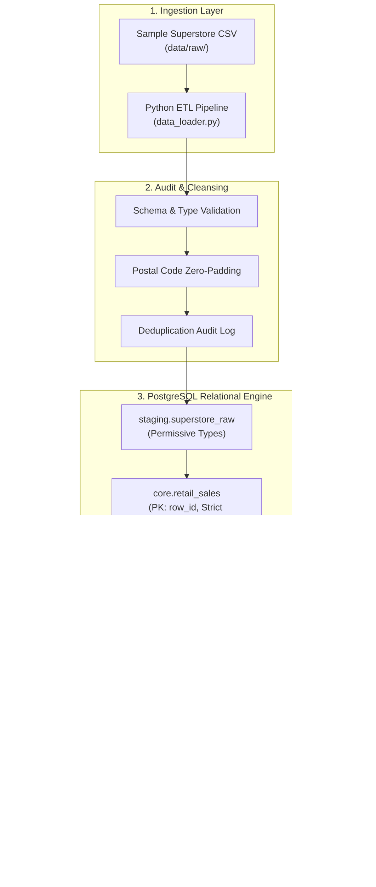

# Data Architecture & Engineering Design

## 1. System Overview

The **Retail Sales Performance Analysis** platform implements an end-to-end modern ELT (Extract-Load-Transform) data architecture. It ingests transactional retail records from raw CSV files, enforces schema validation and data quality auditing, loads normalized records into a PostgreSQL data warehouse, and surfaces business metrics for executive dashboards.



---

## 2. Layered Medallion Architecture

| Layer | PostgreSQL Schema | Storage Model | Purpose |
| :--- | :--- | :--- | :--- |
| **Bronze (Staging)** | `staging` | `staging.superstore_raw` | High-throughput, permissive text landing zone. Captures source records exactly as delivered by legacy systems without rejection risks. |
| **Silver (Core)** | `core` | `core.retail_sales` + Star Schema | Cleansed, strictly typed, relational model with primary keys, foreign keys, index coverage, check constraints, and computed columns. |
| **Gold (Analytics)** | `analytics` | Views & Materialized Tables | Pre-aggregated metric marts, RFM segmentation views, and executive scorecard layers. |

---

## 3. Dimensional Modeling (Star Schema)

While `core.retail_sales` provides a unified flat transactional table for operational analytics, an enterprise **Kimball Star Schema** is also implemented to showcase data warehousing best practices:

- **Fact Table**:
  - `core.fact_sales`: Contains granular sales measures (`sales`, `quantity`, `discount`, `profit`), surrogate transaction key (`row_id`), and foreign keys referencing dimension tables.
- **Dimension Tables**:
  - `core.dim_customers`: Captures customer demographics, segment classifications, first acquisition dates, and lifetime order counts.
  - `core.dim_products`: Captures product catalog identifiers, product titles, and category / sub-category hierarchies.
  - `core.dim_geography`: Normalizes geographic zones (country, region, state, city, and 5-digit postal code).
  - `core.dim_date`: Enterprise date spine spanning 2014 through 2018 with calendar attributes (year, quarter, month, day of week, weekend flags).

---

## 4. Idempotent Ingestion & Duplicate Prevention

To prevent accidental duplicate data loading during repeated batch runs:
1. **Primary Key Enforcement**: The `row_id` column acts as the canonical primary key in `core.retail_sales`.
2. **PostgreSQL Upsert Pattern**:
   ```sql
   INSERT INTO core.retail_sales (...)
   VALUES (...)
   ON CONFLICT (row_id) DO UPDATE SET
       sales = EXCLUDED.sales,
       profit = EXCLUDED.profit,
       ...;
   ```
3. **Audit Trail**: Identical line item entries on the same order are flagged in `core.v_duplicate_line_items` with window function ranking (`ROW_NUMBER() OVER (...)`) rather than being silently deleted.

---

## 5. Indexing Strategy

To guarantee sub-second analytical query execution:
- **B-Tree Indexes** on join and filtering columns:
  - `order_id`, `customer_id`, `product_id`
  - `order_date` (temporal range filters and window partition scans)
  - `(category, sub_category)` (hierarchical roll-ups)
  - `(region, state)` (geographic slicing)
  - `(order_date, region)` (composite index for regional trend queries)
